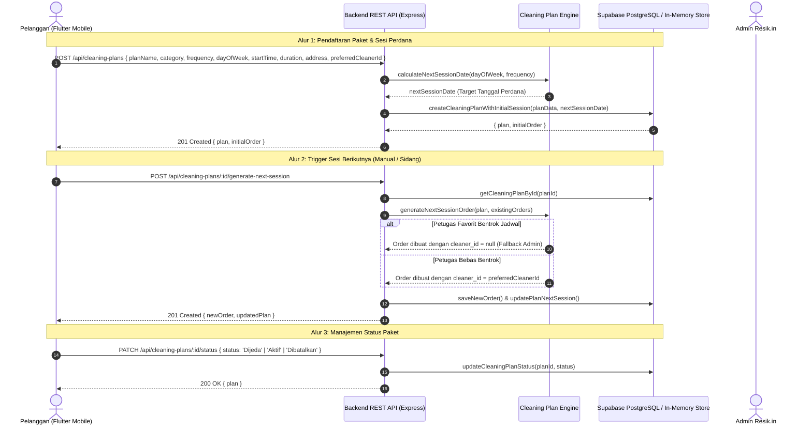

# Spesifikasi Desain: Cleaning Plan (Layanan Rutin Berkala & Paket Langganan Cerdas)

> **Dokumen:** `docs/superpowers/specs/2026-10-13-cleaning-plan-design.md`  
> **Status:** Approved Architecture Specification (PM, Senior Software Engineer & QA Hardened)  
> **Tanggal:** 13 Oktober 2026  
> **Target Rilis:** Phase 3 / V2.0 — Rutinitas Pembersihan & Retensi Pengguna Jangka Panjang (FR-12)  
> **Referensi SOT:** `docs/PRD-Resik.in.md`, `docs/ARCHITECTURE.md`, `docs/BUSINESS-RULES.md`, `docs/API.md`, `docs/SECURITY.md`, `database/schema.sql`

---

## 1. Latar Belakang, Problem Statement, & Urgensi Produk

### 1.1 Kondisi Saat Ini (*Current State*)
Pada arsitektur Resik.in V1 (Core Booking & Quality Report) dan V1.1 (Customer Reviews):
- Pelanggan hanya dapat memesan layanan secara ad-hoc / satuan (*one-time booking*).
- Untuk pelanggan berulang (seperti penghuni kos mahasiswa atau perkantoran rintisan yang membutuhkan pembersihan berkala setiap minggu), pelanggan harus mengisi formulir pemesanan, memilih jam, menentukan alamat, dan mencari petugas dari awal setiap kali membutuhkan jasa.
- Hal ini menimbulkan friksi repetitif dan risiko kelupaan memesan, yang berujung pada hilangnya jadwal reguler petugas favorit mereka.

### 1.2 Masalah yang Dipecahkan (*Problem Statement*)
1. **Friksi Pemesanan Berulang (*Repetitive Booking Friction*)**: Pelanggan rutin menginginkan kepastian hunian bersih tanpa repot membuka aplikasi dan mengisi data yang sama setiap minggu.
2. **Ketiadaan Kepastian Jadwal Petugas Langganan**: Pada sistem ad-hoc, petugas kebersihan yang sudah dipercaya pelanggan sering kali sudah terlanjur dipesan orang lain di jam favorit mereka.
3. **Penyelesaian Roadmap V2 / Phase 3 Skripsi**: Sesuai dokumen acuan `docs/PRD-Resik.in.md` (FR-12) dan `docs/ROADMAP.md`, modul *Cleaning Plan* adalah tonggak utama fase V2.0 yang membuktikan kematangan sistem dalam mengelola retensi pengguna jangka panjang.

### 1.3 Tujuan Desain (*Design Objectives*)
1. **Model Langganan Server-Authoritative**: Menyimpan konfigurasi jadwal rutin (frekuensi mingguan/dua mingguan, hari tetap, jam kedatangan, dan preferensi petugas) di basis data relasional.
2. **Dual-Generator Terintegrasi**: 
   - *Otomasi Sistem:* Secara otomatis menghasilkan pesanan sesi perdana (Order #1) berstatus `Menunggu Konfirmasi` (Belum Bayar) begitu paket langganan diaktifkan.
   - *Trigger Cepat Sidang:* Menyediakan tombol *"Jadwalkan Sesi Berikutnya"* di UI mobile untuk kemudahan demonstrasi langsung di hadapan dosen penguji tanpa harus menunggu pergantian hari kalender.
3. **Zero Double-Booking & Graceful Conflict Fallback**:
   - Menghitung interval kerja + buffer 30 menit.
   - Jika petugas langganan favorit sedang bentrok jadwal pada tanggal sesi target, pesanan tidak digagalkan, melainkan otomatis dialihkan ke alokasi Admin / Smart Matching (`cleaner_id = null`) dengan catatan sistem transparan.
4. **Idempotensi Mutlak**: Menjamin tidak akan pernah ada pesanan ganda untuk paket dan tanggal sesi yang sama meskipun tombol trigger ditekan berulang kali.
5. **Kontrol Penuh di Tangan Pelanggan**: Pelanggan dapat Menjeda (*Pause*), Melanjutkan (*Resume*), atau Membatalkan (*Cancel*) paket langganan kapan saja.

---

## 2. Kriteria Keberterimaan Produk (*Acceptance Criteria*)

| ID AC | Modul / Skenario | Given - When - Then | Hasil yang Diharapkan |
| :--- | :--- | :--- | :--- |
| **AC-CP-01** | Akses Menu Langganan | **Given** pelanggan berada di Beranda atau Tab Pesanan<br>**When** menekan banner promosi atau tab "Paket Rutin"<br>**Then** aplikasi membuka layar `CleaningPlansScreen` menampilkan daftar paket aktif dan tombol buat baru. | Titik masuk intuitif dan mulus. |
| **AC-CP-02** | Pembuatan Paket & Sesi Perdana | **Given** pelanggan mengisi form `CreateCleaningPlanScreen` (nama paket, properti, hari, jam, frekuensi, alamat, opsi petugas)<br>**When** menekan tombol "Aktifkan Paket Langganan"<br>**Then** backend menyimpan paket di `cleaning_plans` dan **otomatis membentuk Order Sesi #1** berstatus `Menunggu Konfirmasi` (Belum Bayar). | Sesi perdana langsung tersedia di tab Pesanan. |
| **AC-CP-03** | Idempotensi Trigger Sesi Berikutnya | **Given** paket langganan berstatus `Aktif`<br>**When** pengguna atau sistem memicu pembentukan sesi berikutnya dua kali secara cepat<br>**Then** sistem hanya membuat tepat 1 pesanan untuk tanggal target tersebut dan menolak duplikasi. | Mencegah penumpukan pesanan ganda. |
| **AC-CP-04** | Fallback Jadwal Bentrok Petugas | **Given** pelanggan memilih petugas favorit Pak Joko pada hari Senin 09:00, namun Pak Joko sudah terikat pesanan lain pada jam tersebut<br>**When** sesi pesanan dibentuk<br>**Then** pesanan tetap terbit dengan `cleaner_id = null` dan catatan `[Jadwal Bentrok] Petugas langganan sedang bertugas. Dialokasikan oleh Admin.` | Alur layanan tidak terhenti, aturan anti-double booking terlindungi. |
| **AC-CP-05** | Siklus Jeda & Lanjut (Pause & Resume) | **Given** paket langganan berstatus `Aktif`<br>**When** pelanggan menekan tombol "Jeda Paket"<br>**Then** status paket berubah menjadi `Dijeda`, trigger sesi baru diblokir hingga paket diaktifkan kembali. | Pelanggan bebas mengatur jeda saat liburan. |
| **AC-CP-06** | Pembatalan Permanen | **Given** pelanggan ingin berhenti berlangganan<br>**When** pelanggan menekan "Batalkan Langganan" dan mengonfirmasi dialog<br>**Then** status paket berubah permanen menjadi `Dibatalkan` dan terkunci dari mutasi baru. | Transparansi hak berhenti berlangganan. |
| **AC-CP-07** | Integrasi Siklus 7 Status & Selesai | **Given** pesanan hasil Cleaning Plan sedang dikerjakan petugas<br>**When** petugas mengirimkan Laporan Mutu (`POST /api/quality-reports`) dan status menjadi `Selesai`<br>**Then** kolom `total_sessions_completed` pada paket langganan induk otomatis bertambah $+1$. | Sinkronisasi akurat counter sesi tuntas. |
| **AC-CP-08** | Lencana Khusus Pelacakan | **Given** pelanggan membuka `OrderTrackingScreen` untuk pesanan dari langganan<br>**When** layar dimuat<br>**Then** muncul banner lencana `✨ Pesanan dari Paket Langganan: [Nama Paket] • Sesi #[Nomor Sesi]`. | Pembeda visual antara pesanan satuan vs langganan. |

---

## 3. Arsitektur Sistem & Alur Data (*System Architecture & Data Flow*)



---

## 4. Skema Basis Data & Model Relasional

### 4.1 Tabel Baru: `cleaning_plans`
Dilengkapi *defensive constraints* hasil peninjauan QA & SSE:

```sql
CREATE TABLE IF NOT EXISTS cleaning_plans (
  id UUID PRIMARY KEY DEFAULT gen_random_uuid(),
  customer_id UUID NOT NULL REFERENCES users(id) ON DELETE CASCADE,
  plan_name VARCHAR(100) NOT NULL CHECK (LENGTH(TRIM(plan_name)) >= 3),
  service_category VARCHAR(50) NOT NULL CHECK (service_category IN ('rumah', 'kos', 'kantor', 'pasca_renovasi')),
  service_id VARCHAR(100),
  frequency VARCHAR(30) NOT NULL CHECK (frequency IN ('mingguan', 'dua_mingguan')),
  day_of_week INT NOT NULL CHECK (day_of_week BETWEEN 1 AND 7), -- 1=Senin, ..., 7=Minggu
  day_name VARCHAR(20) NOT NULL CHECK (day_name IN ('Senin', 'Selasa', 'Rabu', 'Kamis', 'Jumat', 'Sabtu', 'Minggu')),
  start_time VARCHAR(5) NOT NULL CHECK (start_time ~ '^(0[8-9]|1[0-7]):[0-5][0-9]$'), -- Format HH:mm (08:00 - 17:59)
  duration INT NOT NULL CHECK (duration BETWEEN 1 AND 4), -- 1 - 4 Jam
  price_per_session INT NOT NULL CHECK (price_per_session > 0),
  address TEXT NOT NULL CHECK (LENGTH(TRIM(address)) >= 10),
  landmark TEXT,
  notes TEXT,
  preferred_cleaner_id UUID REFERENCES cleaners(id) ON DELETE SET NULL,
  status VARCHAR(20) NOT NULL DEFAULT 'Aktif' CHECK (status IN ('Aktif', 'Dijeda', 'Dibatalkan')),
  next_session_date DATE NOT NULL,
  last_generated_date DATE,
  total_sessions_completed INT NOT NULL DEFAULT 0 CHECK (total_sessions_completed >= 0),
  created_at TIMESTAMPTZ DEFAULT NOW(),
  updated_at TIMESTAMPTZ DEFAULT NOW()
);

-- Indeks Relasional untuk Performa Query
CREATE INDEX IF NOT EXISTS idx_cleaning_plans_customer ON cleaning_plans(customer_id);
```

### 4.2 Alterasi Tabel `orders`:
```sql
ALTER TABLE orders 
ADD COLUMN IF NOT EXISTS cleaning_plan_id UUID REFERENCES cleaning_plans(id) ON DELETE SET NULL,
ADD COLUMN IF NOT EXISTS session_number INT DEFAULT NULL;

CREATE INDEX IF NOT EXISTS idx_orders_cleaning_plan ON orders(cleaning_plan_id);
```

---

## 5. Logika Backend & Kontrak REST API

### 5.1 Modul Logika Penjadwalan (`backend/lib/cleaning-plan-engine.js`)
* **`calculateNextSessionDate({ dayOfWeek, frequency, fromDate })`**:
  * Menghitung tanggal target terdekat:
    $$\text{diff} = (\text{targetDay} - \text{currentDay} + 7) \pmod 7$$
    *(Jika target hari ini tetapi jam mulai sudah lewat, lompat ke minggu depan).*
  * Jika frekuensi dua mingguan, sesi berikutnya berselisih $+14\text{ hari}$.
* **`generateNextSessionOrder({ plan, existingOrders, cleaners })`**:
  * Pengecekan idempotensi: memastikan pesanan untuk `plan.id` pada tanggal target belum pernah dibuat.
  * Pengecekan bentrok jadwal pada `preferred_cleaner_id`: menggunakan interval `start_time` s.d. `end_time` + buffer operasional 30 menit. Jika bentrok, *graceful fallback* ke alokasi Admin.

### 5.2 Kontrak Endpoint REST API (`backend/routes/cleaning-plans.js`)

#### 1. `POST /api/cleaning-plans`
* **Deskripsi:** Membuat paket langganan baru dan langsung membentuk Order Sesi #1.
* **Request Body:**
  ```json
  {
    "customerId": "usr-cust-001",
    "planName": "Langganan Bersih Kos Putri",
    "serviceCategory": "kos",
    "serviceId": "srv-002",
    "frequency": "mingguan",
    "dayOfWeek": 1,
    "dayName": "Senin",
    "startTime": "09:00",
    "duration": 2,
    "address": "Jl. Kaliurang KM 14.5, Kos Melati No. 4",
    "landmark": "Pagar hitam depan warung",
    "notes": "Fokus bersihkan kamar mandi dan balkon",
    "preferredCleanerId": "cln-001"
  }
  ```
* **Response (201 Created):**
  ```json
  {
    "success": true,
    "message": "Paket langganan dan sesi perdana berhasil diaktifkan",
    "data": {
      "plan": { ... },
      "initialOrder": {
        "id": "ord-session-001",
        "status": "Menunggu Konfirmasi",
        "statusPembayaran": "Belum Bayar",
        "sessionNumber": 1
      }
    }
  }
  ```

#### 2. `GET /api/cleaning-plans`
* **Query Params:** `?customer_id=...`
* **Response (200 OK):** Mengembalikan daftar paket dengan data teragregasi (*hydrated* dengan objek petugas favorit dan jumlah pesanan aktif).

#### 3. `GET /api/cleaning-plans/:id`
* **Response (200 OK):** Detail paket lengkap beserta array riwayat seluruh pesanan terkait (`orders`).

#### 4. `PATCH /api/cleaning-plans/:id/status`
* **Request Body:** `{ "status": "Dijeda" | "Aktif" | "Dibatalkan" }`
* **Validasi:** Status `Dibatalkan` bersifat final dan tidak dapat diaktifkan kembali.

#### 5. `POST /api/cleaning-plans/:id/generate-next-session`
* **Deskripsi:** Memicu pembuatan pesanan sesi berikutnya secara instan (fitur demo sidang skripsi).
* **Response (201 Created):** Mengembalikan pesanan baru dan pembaruan tanggal sesi berikutnya pada paket.

---

## 6. Antarmuka Mobile Flutter & Alur UX

### 6.1 Struktur Layar & Komponen
1. **`HomeScreen` Integration:**
   * Banner Promosi Interaktif di Beranda pelanggan bernavigasi ke `CleaningPlansScreen`.
2. **`CustomerOrdersScreen` Integration:**
   * Segmented Tab di atas: `[ Pesanan Satuan ]` | `[ Paket Langganan Rutin ]`.
3. **`CleaningPlansScreen` (`mobile/lib/screens/cleaning_plans_screen.dart`):**
   * Kartu Ringkasan Paket: Menampilkan nama paket, ikon kategori, jadwal hari & jam, avatar petugas langganan, estimasi biaya per kedatangan, badge status, dan counter sesi tuntas.
   * Aksi Kartu: Tombol *"Jeda"*, *"Aktifkan"*, *"Jadwalkan Sesi Berikutnya"* (ikon petir), dan *"Batalkan"*.
   * FAB: `+ Buat Paket Baru`.
   * Empty State ramah pengguna jika belum memiliki langganan.
4. **`CreateCleaningPlanScreen` (`mobile/lib/screens/create_cleaning_plan_screen.dart`):**
   * Formulir pendaftaran: Isian nama paket, seleksi properti, chip frekuensi (Mingguan / 2 Mingguan), chip 7 hari (Senin–Minggu), dropdown jam mulai operasional, chip durasi (1–4 jam), alamat, dropdown petugas favorit, dan kotak ringkasan komitmen biaya per kedatangan.
5. **`OrderTrackingScreen` Badge:**
   * Pesanan hasil langganan menampilkan badge khusus: `✨ Pesanan dari Paket Langganan: [Nama Paket] • Sesi #[Nomor Sesi]`.

---

## 7. Rencana Pengujian TDD & Matriks Verifikasi

### 7.1 Backend Test Matrix (`npm test`)
* **`backend/test/cleaning_plan_engine.test.js`**:
  * TC-CP-ENG-01: Kalkulasi tanggal mingguan (+7 hari).
  * TC-CP-ENG-02: Kalkulasi tanggal dua mingguan (+14 hari).
  * TC-CP-ENG-03: Pergeseran otomatis ke minggu depan jika jam hari ini telah berlalu.
  * TC-CP-ENG-04: Idempotensi (mencegah duplikasi pesanan untuk tanggal target sama).
  * TC-CP-ENG-05: Fallback jadwal bentrok petugas favorit ke Admin (`cleaner_id = null`).
* **`backend/test/cleaning_plans.test.js`**:
  * TC-CP-API-01: `POST /api/cleaning-plans` membuat paket + Order Sesi #1.
  * TC-CP-API-02: Validasi input (panjang nama minimal 3, alamat minimal 10, jam 08:00–17:00).
  * TC-CP-API-03: `GET /api/cleaning-plans` isolasi RBAC & payload ter-hidrasi.
  * TC-CP-API-04: `PATCH /api/cleaning-plans/:id/status` transisi `Aktif` $\leftrightarrow$ `Dijeda` dan kunci `Dibatalkan`.
  * TC-CP-API-05: `POST /api/cleaning-plans/:id/generate-next-session` sukses pada paket aktif, tolak pada paket dijeda/batal.
  * TC-CP-API-06: Verifikasi backward-compatibility seluruh 106 test backend eksisting.

### 7.2 Mobile Flutter Test Matrix (`flutter test`)
* **`mobile/test/cleaning_plan_model_test.dart`**:
  * TC-CP-MOB-01: Serialisasi & deserialisasi JSON null-safe model `CleaningPlan`.
* **`mobile/test/cleaning_plans_screen_test.dart`**:
  * TC-CP-MOB-02: Render kartu paket lengkap dengan badge status warna & info petugas.
  * TC-CP-MOB-03: Interaksi tombol Jeda, Aktifkan, dan dialog konfirmasi Pembatalan.
  * TC-CP-MOB-04: Tampilan empty state ketika daftar paket kosong.
* **`mobile/test/create_cleaning_plan_screen_test.dart`**:
  * TC-CP-MOB-05: Validasi formulir pendaftaran paket baru.
  * TC-CP-MOB-06: Kalkulasi dinamis kotak ringkasan biaya per kedatangan.
* **`mobile/test/cleaning_plan_entry_point_test.dart`**:
  * TC-CP-MOB-07: Navigasi dari Banner Beranda ke `CleaningPlansScreen`.
* **`mobile/test/order_model_test.dart`**:
  * TC-CP-MOB-08: Uji regresi memastikan pesanan reguler lama tetap ter-parse normal tanpa `cleaning_plan_id`.

### 7.3 Standar Kualitas (Quality Gates):
* Backend: 106 test eksisting + test baru lulus 100% (`npm test`).
* Mobile: 73 test eksisting + test baru lulus 100% (`flutter test`).
* Analisis Statis: `flutter analyze` menghasilkan **0 issues found**.
