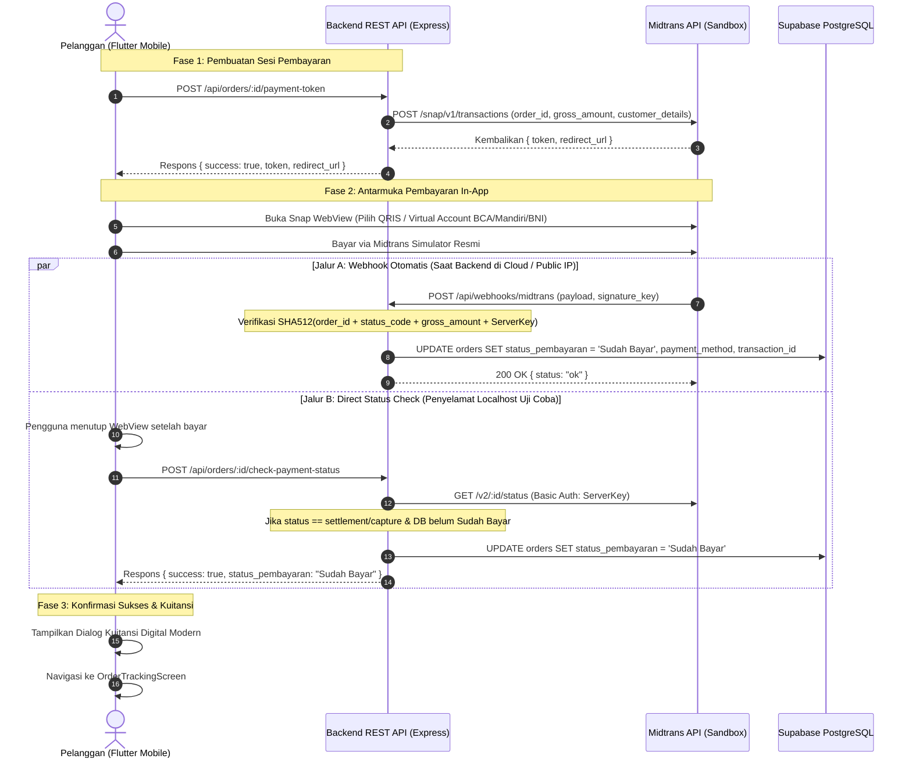

# Spesifikasi Desain: Integrasi Payment Gateway Sandbox (Midtrans Snap) Dual-Mode

> **Dokumen:** `docs/superpowers/specs/2026-10-16-midtrans-payment-gateway-design.md`  
> **Status:** Approved Architecture Specification (PM, Senior SE & Mobile UI/UX Hardened)  
> **Tanggal:** 16 Oktober 2026  
> **Target Rilis:** Phase 3.5 / V2.1 — Real Payment Infrastructure Integration  
> **Referensi SOT:** `docs/PRD-Resik.in.md`, `docs/ARCHITECTURE.md`, `docs/BUSINESS-RULES.md`, `docs/API.md`, `docs/SECURITY.md`, `database/schema.sql`

---

## 1. Latar Belakang, Problem Statement, & Urgensi Produk

### 1.1 Kondisi Saat Ini (*Current State*)
Pada prototipe Resik.in V1 s.d. V2.0:
- Alur pembayaran pesanan menggunakan simulasi *server-authoritative* (`POST /api/orders/:id/pay`).
- Di antarmuka mobile `PaymentScreen`, tombol utama bertuliskan *"Bayar Sekarang (Simulasi)"* dengan kartu catatan bahwa sistem menggunakan simulasi *checkout dummy*.
- Pengguna tidak memiliki pengalaman memilih kanal pembayaran perbankan Indonesia yang nyata (QRIS, BCA VA, Mandiri Bill, BNI/BRI VA, GoPay, ShopeePay).

### 1.2 Masalah yang Dipecahkan (*Problem Statement*)
1. **Persepsi Kredibilitas Produk (*Brand & Academic Perception*)**: Tombol bertuliskan "Simulasi" mengurangi impresi profesionalisme sistem di mata pengguna dan dosen penguji skripsi.
2. **Ketiadaan Alur Pembayaran Standar Industri**: Industri layanan *on-demand* modern di Indonesia mewajibkan integrasi *Instant Payment Notification (IPN)* melalui webhook dan verifikasi tanda tangan kriptografis (*digital signature verification*).
3. **Kesiapan Komersial (*Production Readiness*)**: Transisi dari simulasi *mock* menjadi gerbang pembayaran resmi Midtrans Snap menjamin kesiapan sistem jika Resik.in diluncurkan secara komersial pasca-skripsi.

### 1.3 Tujuan Desain (*Design Objectives*)
1. **Otentik Tanpa Risiko Finansial**: Mengintegrasikan **Midtrans Snap Sandbox** sehingga pengguna dapat melakukan transaksi nyata dengan QRIS simulator atau Virtual Account bank tanpa memotong saldo rekening pribadi asli.
2. **Arsitektur Dua Jalur (*Dual-Path Synchronization*)**: Menggabungkan **Jalur A (Webhook Asinkron Real-Time)** untuk lingkungan cloud publik dan **Jalur B (Direct Status Check)** untuk uji coba lokal (*localhost*) tanpa ketergantungan pada alat *tunneling* (seperti Ngrok).
3. **Penyelamat Demo Sidang (*Zero-Failure Dual-Mode Engine*)**: Memiliki mode *fallback* otomatis ke internal simulator jika `MIDTRANS_SERVER_KEY` belum dipasang atau jaringan internet eksternal terputus saat presentasi sidang.
4. **Pengalaman Pengguna Elegan (Pristine On-Demand UX)**: Menghapus label simulasi, membuka Midtrans Snap dalam *In-App WebView* dengan transisi *slide-up*, dan memunculkan dialog **Kuitansi Pembayaran Digital** dengan nomor referensi transaksi resmi.
5. **Keamanan PCI-DSS & Idempotensi**: Menjaga rahasia server key di backend, memvalidasi tanda tangan digital SHA-512, dan menjamin request ganda tidak merusak integritas state pesanan.

---

## 2. Kriteria Keberterimaan Produk (*Acceptance Criteria*)

| ID AC | Modul / Skenario | Given - When - Then | Hasil yang Diharapkan |
| :--- | :--- | :--- | :--- |
| **AC-PAY-01** | Buka Pembayaran | **Given** pesanan berstatus `Menunggu Konfirmasi` dan `Belum Bayar`<br>**When** pelanggan berada di `PaymentScreen`<br>**Then** tombol menampilkan *"Pilih Metode Pembayaran"* dengan deretan ikon QRIS, GoPay, BCA, Mandiri, BNI. | UI modern tanpa label simulasi dummy. |
| **AC-PAY-02** | Generate Snap Token | **Given** pelanggan menekan *"Pilih Metode Pembayaran"*<br>**When** aplikasi memanggil `POST /api/orders/:id/payment-token`<br>**Then** backend mengembalikan token Midtrans Snap dan redirect URL valid (`200 OK`). | Sesi pembayaran resmi tercipta. |
| **AC-PAY-03** | Buka Snap WebView | **Given** Snap Token berhasil didapatkan<br>**When** aplikasi memuat `MidtransSnapScreen`<br>**Then** WebView membuka antarmuka resmi Midtrans Snap dengan pilihan QRIS dan Multi Virtual Account. | In-App browser berjalan mulus. |
| **AC-PAY-04** | Webhook Sukses (Jalur A) | **Given** pembayaran berhasil di Midtrans Simulator (`settlement`/`capture`)<br>**When** Midtrans mengirimkan notifikasi HTTP POST ke `/api/webhooks/midtrans`<br>**Then** backend memverifikasi SHA-512 signature, memperbarui `status_pembayaran: 'Sudah Bayar'`, serta mencatat `payment_method` dan `payment_transaction_id`. | Transaksi tersimpan sah di database. |
| **AC-PAY-05** | Direct Check (Jalur B) | **Given** aplikasi berjalan di laptop localhost (webhook tidak tembus)<br>**When** pengguna selesai bayar di simulator dan menutup WebView<br>**Then** aplikasi memanggil `POST /api/orders/:id/check-payment-status`, backend menembak API status Midtrans, dan status pesanan otomatis tersinkronisasi menjadi `Sudah Bayar`. | 100% andal di localhost tanpa Ngrok. |
| **AC-PAY-06** | Kuitansi Digital | **Given** pembayaran berhasil diverifikasi<br>**When** pelanggan kembali ke `PaymentScreen`<br>**Then** sistem menampilkan dialog Kuitansi Digital berisi total bayar, metode pembayaran, no. referensi, dan tombol *"Lacak Pesanan Sekarang"*. | Feedback konfirmasi yang melegakan pengguna. |
| **AC-PAY-07** | Dual-Mode Fallback | **Given** `MIDTRANS_SERVER_KEY` kosong di `.env` atau server Midtrans offline<br>**When** pesanan dibayar<br>**Then** backend otomatis beralih ke Mock Simulator internal sehingga proses demo tetap berjalan 100% sukses. | Anti-gagal saat demonstrasi sidang. |
| **AC-PAY-08** | Idempotensi Transaksi | **Given** pesanan sudah berstatus `Sudah Bayar`<br>**When** webhook notifikasi masuk kembali untuk pesanan yang sama<br>**Then** backend merespons `200 OK` tanpa mengubah data atau menduplikasi catatan riwayat status. | Mencegah anomali data ganda. |

---

## 3. Arsitektur Sistem & Alur Dua Jalur (*Dual-Path Data Flow*)



---

## 4. Spesifikasi Database & Kontrak REST API Backend

### 4.1 Skema Data (`orders`)
Pembaruan atribut pada tabel `orders` di PostgreSQL dan In-Memory store:

```sql
ALTER TABLE orders 
ADD COLUMN IF NOT EXISTS payment_method VARCHAR(50) DEFAULT NULL,
ADD COLUMN IF NOT EXISTS payment_transaction_id VARCHAR(100) DEFAULT NULL,
ADD COLUMN IF NOT EXISTS snap_token VARCHAR(255) DEFAULT NULL,
ADD COLUMN IF NOT EXISTS snap_redirect_url TEXT DEFAULT NULL;
```

* **`status_pembayaran`**: Mengakomodasi state `'Belum Bayar'`, `'Sudah Bayar'`, `'Kedaluwarsa'`, `'Gagal'`.
* **`payment_method`**: Menyimpan kanal yang dipilih (`'qris'`, `'bca_va'`, `'bni_va'`, `'mandiri_bill'`, `'gopay'`, dll.).
* **`payment_transaction_id`**: Menyimpan ID unik transaksi dari server Midtrans.
* **`snap_token`**: Menyimpan token transaksi aktif untuk mencegah redundansi *charge*.

---

### 4.2 Endpoint REST API Backend

#### 1. `POST /api/orders/:id/payment-token`
* **Deskripsi:** Membuat sesi transaksi Midtrans Snap untuk pesanan yang belum dibayar.
* **Header:** `Authorization: Bearer <token>`
* **Validasi:**
  * Pesanan harus ditemukan (`404 Not Found`).
  * Pesanan tidak boleh berstatus `Sudah Bayar` (`400 Bad Request`).
  * Jika pesanan sudah memiliki `snap_token` aktif, kembalikan token yang ada (*idempotent session*).
* **Format Respons Sukses (200 OK):**
```json
{
  "success": true,
  "message": "Sesi pembayaran Midtrans berhasil dibuat",
  "data": {
    "order_id": "ord-1792138940-123",
    "token": "79b3df98-5c02-4bb3-8b73-0498a491ef21",
    "redirect_url": "https://app.sandbox.midtrans.com/snap/v2/vtweb/79b3df98-5c02-4bb3-8b73-0498a491ef21"
  }
}
```

#### 2. `POST /api/webhooks/midtrans` (Jalur A)
* **Deskripsi:** Menerima notifikasi HTTP IPN (*Instant Payment Notification*) dari Midtrans.
* **Autentikasi & Keamanan:**
  * Menghitung nilai hash SHA-512:
    $$\text{Expected Signature} = \text{crypto.createHash('sha512')}(\text{order\_id} + \text{status\_code} + \text{gross\_amount} + \text{SERVER\_KEY})$$
  * Wajib menggunakan raw string `gross_amount` dari payload asli untuk menghindari ketidakcocokan desimal.
  * Jika tanda tangan tidak cocok $\rightarrow$ Tolak `403 Forbidden`.
* **Logika Transisi Status:**
  * `settlement` atau (`capture` dan `fraud_status == 'accept'`) $\rightarrow$ `status_pembayaran = 'Sudah Bayar'`.
  * `deny`, `cancel`, `expire` $\rightarrow$ `status_pembayaran = 'Gagal'`.
  * `pending` $\rightarrow$ pertahankan `status_pembayaran = 'Belum Bayar'`.
* **Format Respons (200 OK):**
```json
{ "status": "ok", "message": "Webhook processed successfully" }
```

#### 3. `POST /api/orders/:id/check-payment-status` (Jalur B)
* **Deskripsi:** Memeriksa status transaksi secara proaktif ke Midtrans untuk menyinkronkan status di lingkungan pengujian lokal (*localhost*).
* **Logika:**
  1. Jika database lokal sudah mencatat `Sudah Bayar`, langsung return sukses.
  2. Jika masih `Belum Bayar`, backend menembak API Midtrans: `GET https://api.sandbox.midtrans.com/v2/:id/status` dengan Basic Auth `Base64(MIDTRANS_SERVER_KEY + :)`.
  3. Jika Midtrans merespons status `settlement` atau `capture`, backend langsung memperbarui database.
* **Format Respons Sukses (200 OK):**
```json
{
  "success": true,
  "message": "Status pembayaran berhasil diverifikasi",
  "data": {
    "id": "ord-1792138940-123",
    "status_pembayaran": "Sudah Bayar",
    "payment_method": "qris",
    "payment_transaction_id": "20261016-midtrans-89218",
    "payment_timestamp": "2026-10-16T12:45:00.000Z"
  }
}
```

---

## 5. Spesifikasi Antarmuka Mobile (Flutter) & Penanganan WebView

### 5.1 Perubahan pada `PaymentScreen`
* **Menghilangkan Indikator Simulasi:**
  * Tombol utama: **"Pilih Metode Pembayaran"** (Ikon kartu kredit / dompet).
  * Di atas tombol: Baris logo mini metode bayar (**QRIS, BCA, Mandiri, BNI, GoPay, ShopeePay**).
  * Teks catatan keamanan:  
    *“Pembayaran diproses secara aman melalui Midtrans Payment Gateway. Mendukung QRIS dan Virtual Account Bank.”*

### 5.2 Komponen Layar `MidtransSnapScreen`
* Menggunakan paket `webview_flutter`.
* Menampilkan *In-App WebView* dengan:
  * AppBar putih bersih: judul *"Pembayaran Aman Midtrans"* dan tombol Tutup (X).
  * Indikator progres bar (*LinearProgressIndicator*) warna `AppColors.primary`.
  * Delegasi Navigasi (`NavigationDelegate`):
    * Memfilter URL: mengizinkan `http://` dan `https://`.
    * Memblokir (*prevent*) skema non-http seperti `gojek://` atau `shopeepay://` untuk mencegah galat `ERR_UNKNOWN_URL_SCHEME`.
    * Mendeteksi kata kunci penyelesaian (seperti `#finish`, `payment-finish`) $\rightarrow$ menutup layar secara otomatis dengan sinyal sukses.
  * Proteksi tombol fisik Back Android via `PopScope` agar tidak tertutup tanpa konfirmasi.

### 5.3 Modal Kuitansi Pembayaran Digital (*Delight UX*)
Saat status terkonfirmasi `Sudah Bayar`:
* Menampilkan dialog kuitansi bertema *Pristine On-Demand*:
  * Ikon centang hijau emerald (`AppColors.emerald`) berukuran 56dp.
  * Judul: **Pembayaran Terverifikasi!**
  * Kartu rincian: Total Biaya, Metode Pembayaran, ID Transaksi Midtrans, Waktu Transaksi.
  * Tombol Aksi: **"Lacak Pesanan Sekarang"** (Pill button Sky-600) yang langsung membuka `OrderTrackingScreen`.

---

## 6. Arsitektur Keamanan & Dual-Mode Fallback Engine

### 6.1 Arsitektur Keamanan
* **Zero Secret Leak:** Kunci `MIDTRANS_SERVER_KEY` tidak pernah di-bundle ke file Dart atau dikirim ke klien.
* **Anti-Tampering:** Signature SHA-512 wajib lolos verifikasi sebelum mutasi status dilakukan.
* **Strict State Guard:** Admin dilarang mengonfirmasi pesanan (`Menunggu Konfirmasi` $\rightarrow$ `Dikonfirmasi`) jika status pembayaran bukan `Sudah Bayar`.

### 6.2 Dual-Mode Engine (*Safety Net Demo Sidang*)
```
                ┌───────────────────────────────────┐
                │   Apakah MIDTRANS_SERVER_KEY      │
                │   tersedia di file .env?          │
                └─────────────────┬─────────────────┘
                                  │
                 ┌────────────────┴────────────────┐
                 ▼ (Ya)                            ▼ (Tidak / Demo Darurat)
      [ Mode 1: Cloud Sandbox ]         [ Mode 2: Mock Fallback Engine ]
      - Panggil api.sandbox.midtrans    - Buat Mock Token internal
      - Webhook Midtrans publik         - Buka Mock Simulator interaktif
      - Verifikasi SHA-512 riil         - Auto-settle saat tombol ditekan
```
* **Kelebihan:** Sistem mandiri dan kebal terhadap kegagalan jaringan luar saat demo tugas akhir di kampus.

---

## 7. Strategi Pengujian Otomatis (*Testing Strategy*)

### 7.1 Backend Test Cases (`backend/test/midtrans_payment.test.js`)
* **TC-MID-01:** Sukses membuat Snap token dan redirect URL untuk pesanan aktif (`200 OK`).
* **TC-MID-02:** Menolak pembuatan token jika pesanan sudah `Sudah Bayar` (`400 Bad Request`).
* **TC-MID-03:** Menolak Webhook jika `signature_key` tidak cocok (`403 Forbidden`).
* **TC-MID-04:** Webhook valid status `settlement` mengubah status order menjadi `Sudah Bayar` dan menyimpan payment method (`200 OK`).
* **TC-MID-05:** Uji idempotensi Webhook ganda tanpa merusak data pesanan (`200 OK`).
* **TC-MID-06:** Webhook status `cancel`/`expire` mengubah status menjadi `Gagal` (`200 OK`).
* **TC-MID-07:** Endpoint sinkronisasi Jalur B (`POST /check-payment-status`) menyinkronkan status pesanan secara mandiri.
* **TC-MID-08:** Dual-mode mock fallback berfungsi mulus saat mode sandbox tanpa server key aktif.

### 7.2 Mobile Flutter Test Cases (`mobile/test/payment_screen_test.dart`)
* Verifikasi tombol pembayaran Midtrans dan logo kanal bayar tampil.
* Verifikasi penanganan callback sukses memunculkan dialog Kuitansi Pembayaran.
* Memastikan seluruh 89 test Flutter yang ada sebelumnya tetap 100% lulus (*zero regression*).

---

## 8. Rencana Implementasi Bertahap (*Phased Implementation*)

1. **Fase 1: Backend Database & Payment Engine (`backend/lib/midtrans.js`)**
   - Pembuatan helper Midtrans API client (Snap & Status API).
   - Implementasi Dual-Mode Mock Simulator Fallback.
   - Penambahan kolom payment metadata pada database store.
2. **Fase 2: Backend REST Endpoints & Webhooks (`backend/routes/orders.js` & `backend/routes/webhooks.js`)**
   - Endpoint `POST /api/orders/:id/payment-token`.
   - Endpoint `POST /api/webhooks/midtrans` dengan verifikasi SHA-512.
   - Endpoint `POST /api/orders/:id/check-payment-status`.
   - Penyusunan dan penjalanan suite test backend (`midtrans_payment.test.js`).
3. **Fase 3: Mobile Flutter Integration (`mobile/lib/screens/`)**
   - Penambahan dependensi `webview_flutter` pada `pubspec.yaml`.
   - Pembuatan komponen `MidtransSnapScreen`.
   - Pembaruan `PaymentScreen` (penghapusan label simulasi, integrasi modal sheet Snap, dan dialog Kuitansi Digital).
   - Penjalanan suite test mobile (`flutter test` dan `flutter analyze`).
4. **Fase 4: Verifikasi Menyeluruh & Dokumentasi SOT**
   - Pembaruan dokumen `docs/PRD-Resik.in.md`, `docs/API.md`, dan `docs/ROADMAP.md`.
   - Verifikasi 100% test passing pada Backend & Mobile.
